# NAS Music TV

简体中文 | [English](README_EN.md)

一款开源的 Android 音乐播放器（TV / 手机 / 平板通用）：聚合 NAS（Jellyfin / Navidrome / Subsonic / 道理鱼 / 飞牛）、网络音乐、百度网盘、本地音乐等多音乐源，支持逐字卡拉OK歌词、K 歌伴奏、MTV 音乐视频、天气电台等电视专属体验。同一 APK 同时适配电视（遥控器）与手机（触屏）。

[](https://github.com/hxzhang2000/NASMusicTV/releases)

产品主页：https://hxzhang2000.github.io/NASMusicTV-Website/

> ⚠️ **百度网盘目录限制**：根据百度开放平台 2026 年沙盒策略，第三方应用只能访问 `/apps/NASMusicTV` 目录及其子目录，**无法读取该目录之外的任何文件**。请将音乐文件放入百度网盘的 `/apps/NASMusicTV/` 目录下（例如 `/apps/NASMusicTV/音乐/`），应用内首次使用时会自动创建该目录。放在 `/apps/NASMusicTV/` 之外的文件将无法被本应用访问。

## 功能特性

### 多音乐源

- **NAS**：Jellyfin / Navidrome / Subsonic / 道理鱼 / 飞牛 五种后端，含 CUE 整轨与 HLS 流媒体
- **网络音乐**：在线搜索与播放，5 档音质（自动 / 128 / 192 / 320 / 无损 FLAC），档位不可用时自动降级；搜索命中艺人时可续页取该艺人的全部作品
- **本地音乐**：自动扫描设备与 USB / SD 卡，Room 索引持久化，与 NAS 音乐同一视图浏览
- **百度网盘**：设备码 OAuth 授权，目录浏览、搜索、直链串流
- **独立音乐（Jamendo）**：CC 授权音库，热门榜 + 风格筛选
- **电台**：公共电台目录，标签筛选，直播流即点即播
- **跨源搜索**：NAS / 网络 / 百度 / Jamendo 四源独立开关，并行搜索合并去重

### 播放体验

- **播放控制**：顺序 / 单曲循环 / 列表循环 / 随机四种模式，队列增删改与排序，队列持久化（重启自动恢复）
- **音质**：播放页显示当前档位或真实码率，网络歌曲可随时切换档位，支持单曲指定档位
- **应用内音量**：独立于系统音量（0–100%），设置页与播放页均可调节，跨曲交叉淡入自动适配
- **均衡器与可视化**：均衡器预设与频段调节；全屏沉浸式可视化 30+ 套特效（含 three-globe 3D 地球版「世界」，WebView + WebGL 完全离线渲染，参考 [three-globe](https://github.com/vasturiano/three-globe) 与 [three.js](https://github.com/mrdoob/three.js)）；可视化画质可按设备性能分低/中/高三档选择
- **照片墙可视化**：图库 / 外接存储（U 盘、SD 卡）/ Jellyfin 三来源照片全屏轮播，43 种转场随机切换，可选「仅显示含人像」
- **K 歌**：人声消除伴奏模式、原唱 / 伴奏切换、升降调、播放变速
- **MTV 音乐视频**：播放页一键进入全屏 MV（B 站搜索），切歌自动预搜
- **天气电台**：按实时天气（晴 / 雨 / 雪 / 风 / 阴 / 夜晚）从曲库匹配心情电台，无 NAS 也可用
- **播放统计**：记录播放次数与最后播放时间，驱动「最近播放」

### 歌词

- 逐行滚动 + **逐字高亮**（卡拉 OK 效果），大屏适配
- 多来源获取：内嵌 / 本地 LRC / 网络匹配 / 缓存，可切换来源
- 字号缩放与高亮模式记忆

### 曲库浏览

- 搜索：拼音首字母（`zjl` → 周杰伦）+ 子串匹配
- 发现页：语种 / 纯音乐 / 年代 / 情怀 / 风格 / 主题六维度筛选
- 专辑 / 艺术家 / 流派 / 年代 网格浏览与详情页
- 收藏、最近播放、自建播放列表
- 歌单导入：M3u / 网易云 / JSON / TXT，歌单内 HTTP 直链可直接播放

### TV 体验

- 完整 D-Pad 焦点体系与遥控器优化，支持 HDMI-CEC 媒体键
- **手机遥控**：K 歌 / MTV 全屏页显示二维码，手机扫码后可查看队列、搜索添加歌曲
- 前台媒体通知与锁屏控制

### 手机体验

- 同一 APK 双端：运行时检测设备类型，TV 走顶部导航 + 焦点体系，手机走触屏交互
- 全部页面竖屏 / 横屏适配：底部导航 + 迷你播放条 + 播放页封面 ⟷ 歌词左右滑切换
- 触摸进度条拖拽 seek、曲库响应式网格、按下反馈
- 锁屏与通知栏媒体控制，Android Auto / Wear OS 媒体浏览

## 界面预览

| 首页 | 播放页 |
|:---:|:---:|
| 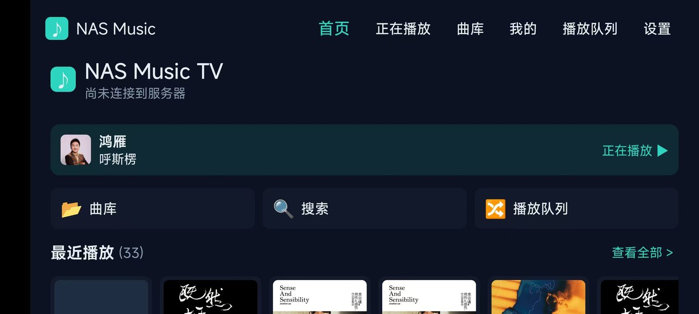<br>**首页**：当前播放 / 最近播放 / 实时天气 / 频谱预览 | 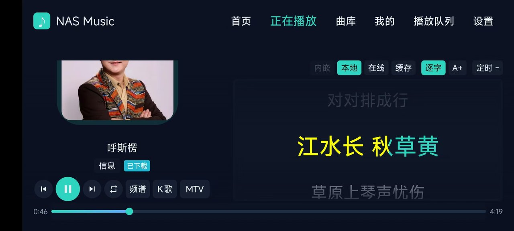<br>**播放页**：封面 + 歌词 + 可视化 + 歌曲详情 |
| 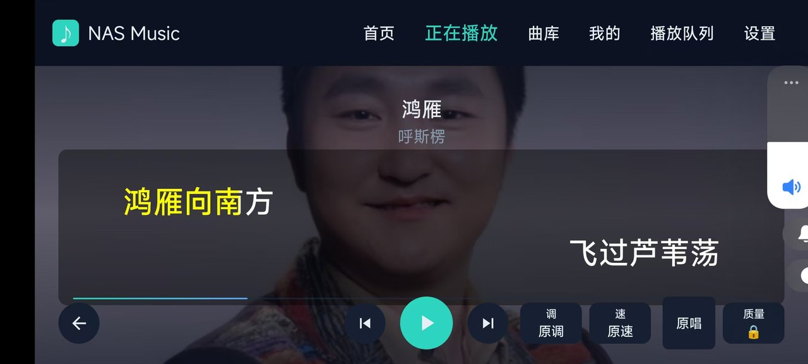<br>**逐字卡拉 OK 歌词** | <br>**MTV 全屏音乐视频** |
| 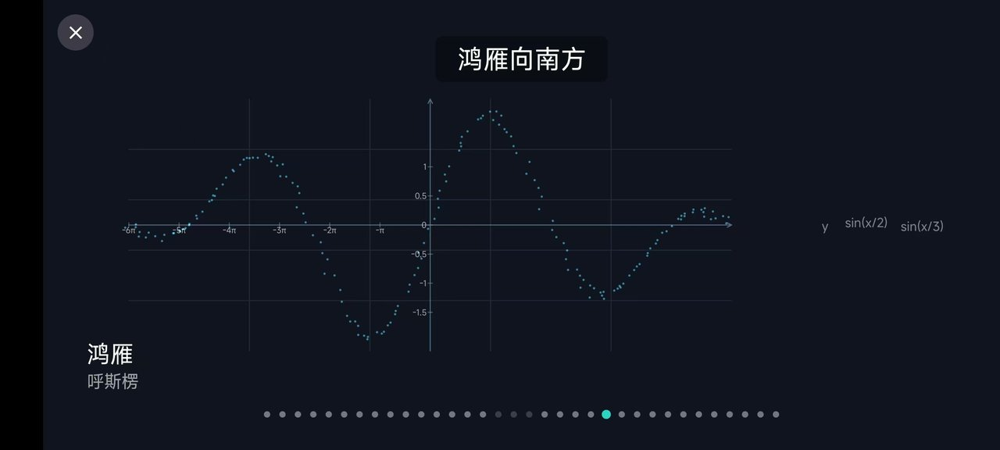<br>**全屏可视化**：30+ 套特效 | 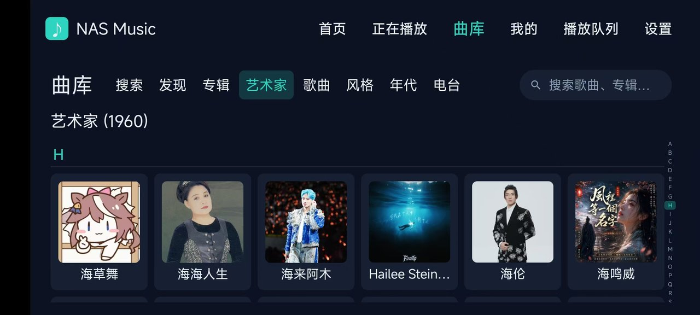<br>**曲库**：专辑 / 艺术家 / 歌曲 / 流派 / 年代 |
| 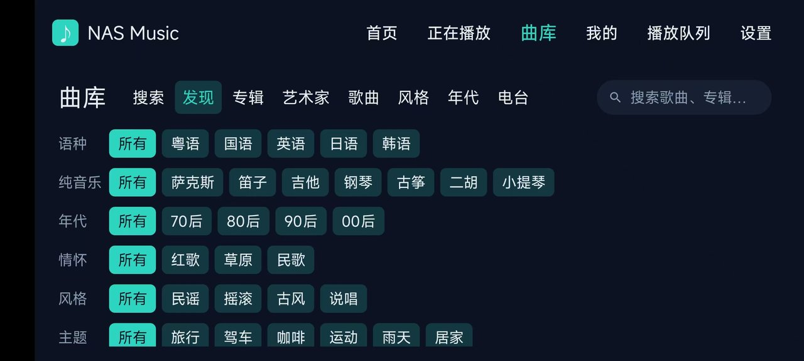<br>**发现页**：六维度筛选 | 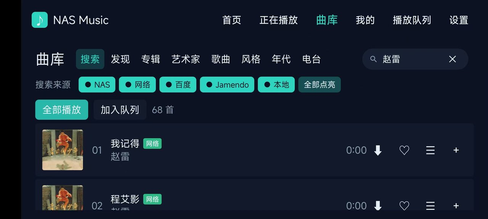<br>**搜索**：拼音首字母 + 子串匹配 |
| 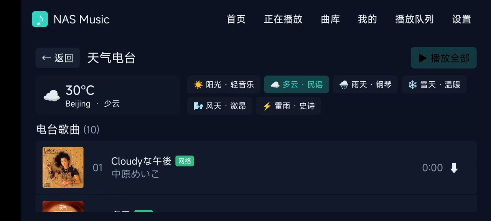<br>**天气电台**：按实时天气匹配心情电台 | 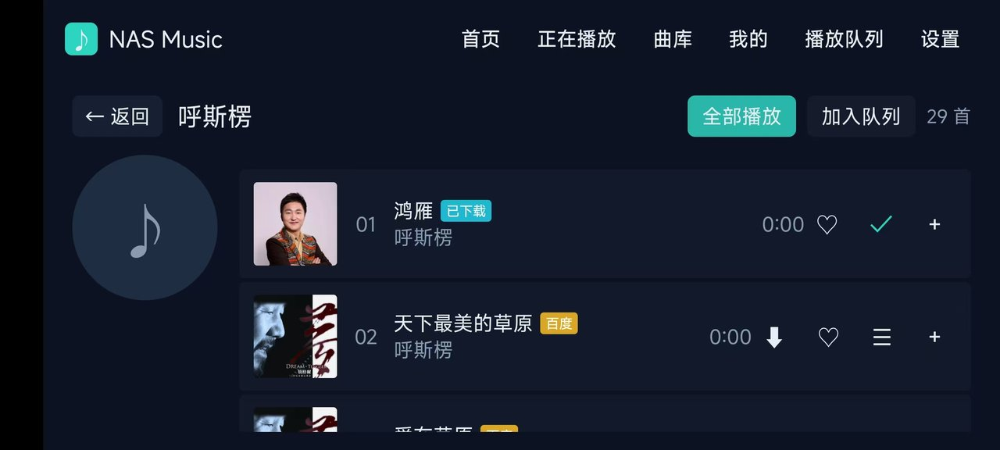<br>**专辑详情** |
| 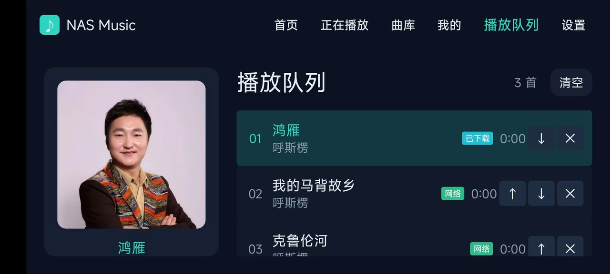<br>**播放队列**：增删改与排序 | 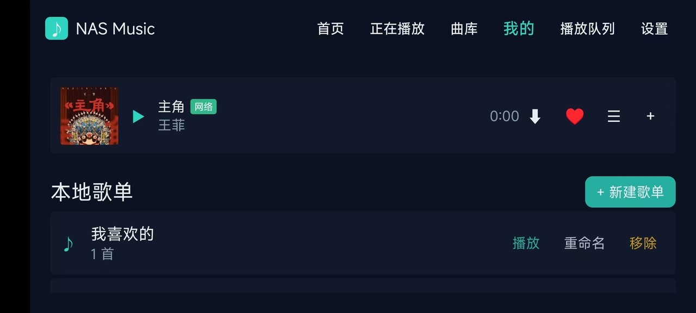<br>**我的**：收藏 / 最近播放 / 本地歌单 |
| 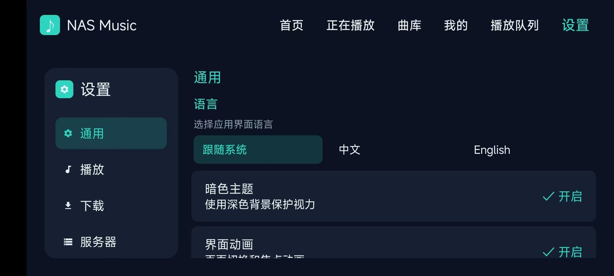<br>**设置**：主题 / 均衡器 / 歌词缩放 / 各音乐源端点 | 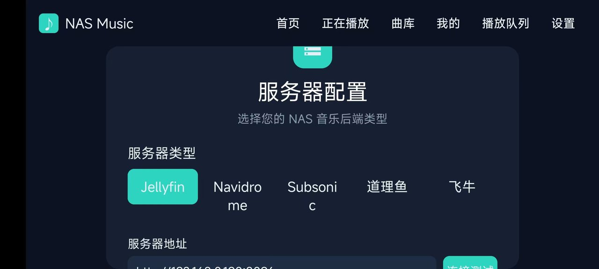<br>**连接页**：五种 NAS 后端 |
| 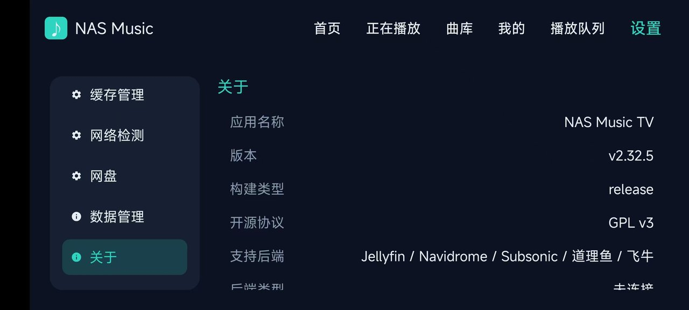<br>**关于**：后端类型 + API 版本 + 连接状态 | 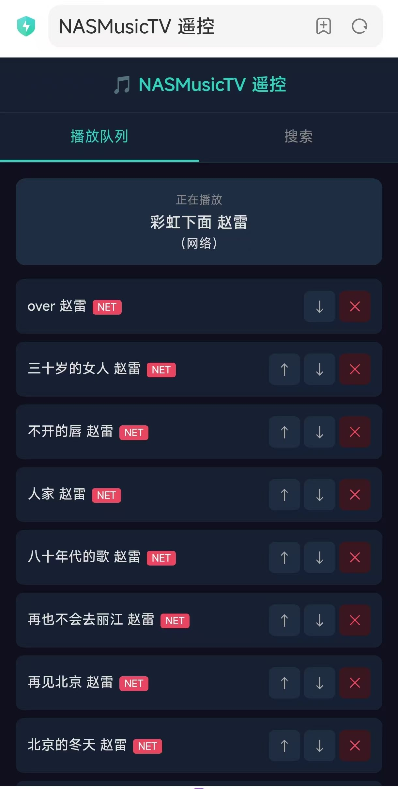<br>**手机遥控**：K 歌 / MTV 全屏页扫码，手机查看队列、搜索加歌 |

## 下载安装

**系统要求**：Android 5.1（API 22）及以上，电视 / 手机 / 平板通用。同一 APK 自动识别设备类型——电视走遥控器焦点体系，手机走触屏交互。搭载 ARMv7 的老电视同样可以安装，高负载特效会自动降级。

**下载地址**：[Releases](https://github.com/hxzhang2000/NASMusicTV/releases) 页的 `app-release.apk`。

**安装到电视**：U 盘拷贝 APK 后用文件管理器安装；或通过 adb 无线安装：

```bash
adb connect <电视IP>:5555
adb -s <电视IP>:5555 install -r app-release.apk
```

**安装到手机 / 平板**：直接安装 APK（需在系统设置里允许"安装未知应用"）。

**首次使用**：进入「连接页」添加你的 NAS 后端（Jellyfin / Navidrome / Subsonic / 道理鱼 / 飞牛）。没有 NAS 也可以直接用网络音乐、百度网盘、公共电台和天气电台。

## 构建与运行

```bash
# 设置 JAVA_HOME
export JAVA_HOME="C:\Program Files\Android\Android Studio\jbr"

# Debug APK
./gradlew assembleDebug

# Release APK
./gradlew assembleRelease

# 运行测试
./gradlew test

# 推送到电视（将 192.168.0.116 替换为你的电视 IP）
adb -s 192.168.0.116:5555 install -r app/build/outputs/apk/debug/app-debug.apk
```

## 已知限制

- **电视端照片墙读不到内置存储的照片**（两平台统一只读外接卷 / Jellyfin / 图库）：电视想展示
  手机或电脑里的照片，请拷到 U 盘 / SD 卡插入后，在「设置 → 照片墙 → 外接存储」选择该卷
- **仅显示含人像**在低画质档不可用（老设备 ARMv7 性能取舍，设置项自动置灰）
- 人脸检测模型与结果库独立于音乐库（`photo_face.db`），「清除人脸结果」只删检测结果、不动照片

## Star History

<a href="https://www.star-history.com/?repos=hxzhang2000%2Fnasmusictv&type=date&legend=top-left">
 <picture>
   <source media="(prefers-color-scheme: dark)" srcset="https://api.star-history.com/chart?repos=hxzhang2000/nasmusictv&type=date&theme=dark&legend=top-left" />
   <source media="(prefers-color-scheme: light)" srcset="https://api.star-history.com/chart?repos=hxzhang2000/nasmusictv&type=date&theme=light&legend=top-left" />
   
 </picture>
</a>

## 开源协议

GPL v3
